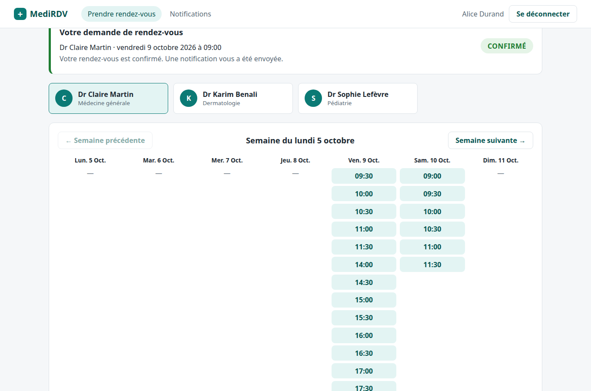
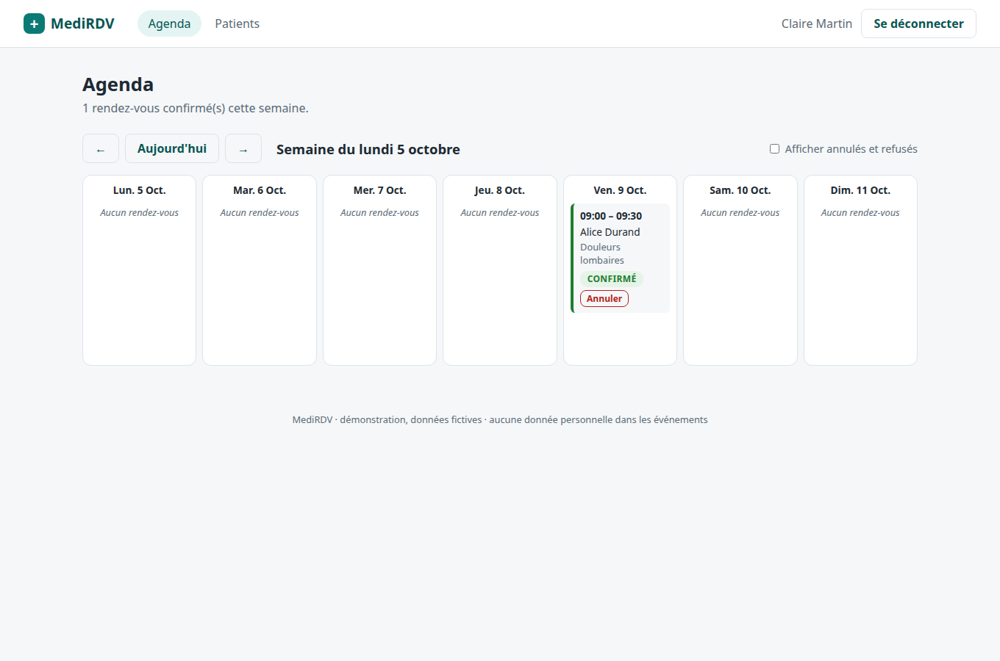
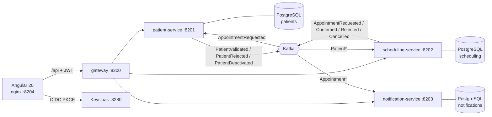

# MediRDV

**Medical appointment booking built as event-driven microservices: Kafka choreography saga,
transactional outbox and one trace per booking across every service.**

[](https://github.com/slimanitz/medirdv/actions/workflows/ci.yml)
[](LICENSE)


## Why this project

Online booking is everywhere in French healthcare (Doctolib, Maiia, hospital portals). Behind
the simple "book" button sit hard problems: no double booking, consistent state across teams'
services, and health data (RGPD article 9) that must not leak into logs or message brokers.
MediRDV shows how to solve them with a saga, an outbox and privacy by design.

## Features

- [x] Free slots computed from weekly availabilities (Europe/Paris, DST-safe), past and taken slots excluded
- [x] Booking saga: `PENDING_VALIDATION` → `CONFIRMED` (patient validated) or `REJECTED` (compensation, slot released)
- [x] Saga timeout: pending bookings older than 2 minutes are rejected automatically
- [x] Live status in the UI (polling every 2 s): "EN ATTENTE" → "CONFIRMÉ"
- [x] Cancellation by patient, practitioner or admin with a coded reason (the optional comment never leaves the service), notification to the patient
- [x] Patient deactivation cancels all their future appointments (`PatientDeactivated`)
- [x] Rescheduling API (`PATCH /appointments/{id}` → `AppointmentRescheduled` → notification)
- [x] Double-booking protection: exclusion constraint on overlapping time ranges (`btree_gist`), unique index, optimistic locking
- [x] Transactional outbox (polling publisher, advisory lock for ordering across replicas, poison messages parked), idempotent consumers
- [x] Saga consumers: blocking retries with backoff then `<topic>.dlt`; notifications: retry topics then `notification.dlt`
- [x] Keycloak login (OIDC + PKCE), roles `patient` / `practitioner` / `admin`, JWT checked by the gateway **and** every service, fail-closed ownership rules
- [x] Events carry identifiers, dates and codes only (no free text), personal data masked in logs ([RGPD notes](docs/rgpd.md))
- [x] JSON logs with trace ids, Prometheus metrics, one Tempo trace per booking across 4 services, Grafana dashboard
- [x] Docker Compose one-command run, Helm chart, GitHub Actions CI with Testcontainers

| Booking confirmed | Practitioner agenda |
|---|---|
|  |  |

## Architecture



Key decisions:

- **Choreography saga** — scheduling reserves the slot and asks; patient-service answers; scheduling
  confirms or compensates. The saga state is the appointment status. → [ADR 0001](docs/adr/0001-choreography-saga.md)
- **Transactional outbox with a polling publisher** — state change and event in one transaction,
  relayed every 500 ms by one replica at a time (advisory lock, keeps per-appointment order),
  poison rows parked after 5 attempts, at-least-once + idempotent consumers. → [ADR 0002](docs/adr/0002-transactional-outbox-polling-publisher.md)
- **Retries** — blocking retries + `<topic>.dlt` for the saga (order matters), non-blocking retry
  topics for notifications (order of notifications not guaranteed). → [ADR 0004](docs/adr/0004-retry-strategies-per-consumer.md)
- **JSON events from a shared `events` module** — readable, compile-checked contract, identifiers
  only. → [ADR 0003](docs/adr/0003-json-events-over-avro.md)
- **Defence in depth** — the gateway rejects anonymous calls, each service validates the JWT again
  and applies ownership rules (`patient_id` claim).
- **Trace continuity through Kafka** — the request `traceparent` is stored in the outbox row and
  sent as a Kafka header, so consumers join the original trace.

Details, sequence diagram and state machine: [docs/architecture.md](docs/architecture.md).

## Quick start

### With Docker Compose (recommended)

Requirements: Docker with Compose v2+, ~4 GB of free RAM.

```bash
cp .env.example .env              # optional, defaults work as is
docker compose up -d --build      # first build: a few minutes
docker compose ps                 # wait until the services are "healthy"
```

Open **http://localhost:8204** and log in:

| User | Password | Role | Lands on |
|---|---|---|---|
| `alice` | `alice` | patient (Alice Durand) | `/book` — book with Dr Martin, watch "CONFIRMÉ", `/notifications` |
| `dr.martin` | `dr.martin` | practitioner (Dr Claire Martin) | `/agenda` — week view, cancel |
| `admin` | `admin` | admin / secretariat | `/patients` — list, create, deactivate |

Keycloak console: http://localhost:8280/admin (`admin` / `admin`).
The demo users, practitioners and patients are fictitious data loaded only by the Spring profile
`demo` (set by `docker-compose.yml`; never enabled by the Helm chart unless `demoData=true`).
Jean Moreau (`00000000-0000-4000-a000-000000000004`) is an inactive patient, useful to see a rejected saga.

Drive the whole saga from the command line:

```bash
scripts/demo-saga.sh   # alice books, saga confirms, notification, dr.martin cancels, cancellation notification
TOKEN=$(scripts/token.sh alice)    # password grant on the dev-only client medirdv-cli; also dr.martin / admin
curl -H "Authorization: Bearer $TOKEN" http://localhost:8200/api/notifications
```

Observability profile (Prometheus, Tempo, Grafana) with trace export:

```bash
make up-obs   # = TRACING_EXPORT_ENABLED=true docker compose --profile observability up -d --build
```

- Grafana http://localhost:3200 (anonymous viewer, admin/admin): dashboard *MediRDV · overview*
  (request rate, p95 latency, Kafka consumer lag, outbox backlog, dead letters, recent booking traces).
- **Find a booking trace across services**: book a slot, then in Grafana → Explore → Tempo →
  TraceQL `{ resource.service.name = "gateway" && span.http.method = "POST" }`, open the most recent
  trace. It contains the gateway span, `http post /appointments` in scheduling-service,
  `appointment.events receive` in patient-service, `patient.events receive` back in scheduling-service and
  `appointment.events receive` in notification-service. The same `traceId` appears in every
  service's JSON logs (`docker compose logs scheduling-service | grep <traceId>`).
- Prometheus http://localhost:9290, Tempo API http://localhost:3201.

Actuator (health, Prometheus) is served on management ports 9200-9203, reachable only inside the
compose network (Prometheus scrapes them); the published ports 8200-8203 serve the API only.

Stop and clean: `docker compose --profile observability down -v` (or `make down`).

### Local development

Requirements: Java 21, Maven 3.9, Node 22, Docker (for the infrastructure and tests).

```bash
docker compose up -d kafka patient-db scheduling-db notification-db keycloak
mvn -B -DskipTests install
SPRING_PROFILES_ACTIVE=demo mvn -pl scheduling-service spring-boot:run  # :8202 (demo data), actuator :9202
SPRING_PROFILES_ACTIVE=demo mvn -pl patient-service spring-boot:run     # :8201
mvn -pl notification-service spring-boot:run   # :8203
mvn -pl gateway spring-boot:run                # :8200
cd web && npm ci && npm start                  # http://localhost:4202, /api proxied to :8200 (no /config.json: localhost defaults)
```

### Kubernetes

`deploy/helm/medirdv` deploys the four services (Deployment, Service, ConfigMap, HPA each), the
web app and an Ingress (`/api` → gateway, `/` → web). Kafka, PostgreSQL and Keycloak are expected
outside the chart, e.g. `bitnami/kafka` (KRaft), `bitnami/postgresql` and `bitnami/keycloak`:

```bash
helm install medirdv deploy/helm/medirdv -n medirdv --create-namespace \
  --set external.kafkaBootstrapServers=kafka.infra:9092 \
  --set external.kafkaReplicationFactor=3 \
  --set external.keycloak.issuerUri=https://auth.example.fr/realms/medirdv \
  --set external.database.createSecret=true \
  --set external.database.password=... \
  --set ingress.host=medirdv.example.fr
```

- `image.tag` defaults to the chart `appVersion` (CI pushes `<sha>`, `latest` and the appVersion).
- `external.database.password` is required when `createSecret=true`; otherwise provide the
  `existingSecret` (keys `username`, `password`).
- Pods run as non-root (UID 10001, nginx-unprivileged UID 101) with a read-only root filesystem,
  all capabilities dropped and the `RuntimeDefault` seccomp profile; probes and Prometheus use the
  management port.
- The web image reads its Keycloak URL at start (`/config.json`, `web.keycloakUrl`, default derived
  from `issuerUri`). Import `deploy/keycloak/medirdv-realm.json` with `MEDIRDV_PUBLIC_URL=https://medirdv.example.fr`
  in Keycloak's environment so the public URL is accepted as redirect URI / web origin, and do not
  import the dev-only `medirdv-cli` client (password grant) in production.

## API overview

All routes go through the gateway (`http://localhost:8200/api/...`) with `Authorization: Bearer <token>`.

| Method | Path | Role | Description |
|---|---|---|---|
| GET | `/api/practitioners` | any | Practitioners |
| GET | `/api/practitioners/{id}/slots?from=YYYY-MM-DD&to=YYYY-MM-DD` | any | Free slots (max 31 days) |
| POST | `/api/appointments` `{practitionerId, start, reason}` | patient (staff: + `patientId`) | Starts the saga, `202` + `PENDING_VALIDATION` |
| GET | `/api/appointments/{id}` | owner, the appointment's practitioner, admin | Appointment and saga status |
| GET | `/api/appointments` | patient: own only; practitioner: own agenda `?from=&to=` or `?patientId=` (their appointments with that patient); admin: `?practitionerId=` or `?patientId=` | Lists |
| DELETE | `/api/appointments/{id}?reasonCode=&comment=` | owner, the appointment's practitioner, admin | Cancel → `AppointmentCancelled` with the code only; `comment` (≤ 500) stays in the DB |
| PATCH | `/api/appointments/{id}` `{start}` | owner, the appointment's practitioner, admin | Reschedule a confirmed appointment |
| GET/POST | `/api/patients` | practitioner, admin | List / create patients |
| GET/PUT | `/api/patients/{id}` | staff or the patient themself | Read / update |
| GET | `/api/patients/me` | patient | Own record |
| POST | `/api/patients/{id}/deactivate` | practitioner, admin | Deactivate → `PatientDeactivated` |
| GET | `/api/notifications[?patientId=]` | patient: own; practitioner: of their appointments; admin: latest or by patient | Notifications |

Errors are RFC 9457 problem details with French messages (`409` slot taken or overlapping,
`403` "Accès refusé à ce rendez-vous", `400` invalid range or comment too long...).
A practitioner account without a `practitioner_id` attribute is refused (`403`), never widened.

Kafka topics: `appointment.events`, `patient.events`, dead letter topics `patient.events.dlt`,
`appointment.events.dlt`, `notification.dlt` (+ retry topics `appointment.events-retry-*`).
Partitions / replication factor: `MEDIRDV_KAFKA_PARTITIONS` (3) / `MEDIRDV_KAFKA_REPLICAS` (1, use 3 in production).
Envelope: `{eventId, type, occurredAt, traceparent?, payload}`.

## Testing

```bash
mvn -B verify                    # all modules: unit + Testcontainers integration tests (Docker required)
mvn -B -pl scheduling-service -am verify   # one service, as in CI
cd web && npm ci && npm run test:ci        # Angular unit tests (headless Chrome)
cd web && npx ng build                     # production build
helm lint deploy/helm/medirdv
scripts/demo-saga.sh                       # end-to-end saga against the running compose stack
```

What is covered:

- **Unit**: slot computation incl. DST change and spring-forward gap (`SlotCalculatorTest`), saga
  state transitions (`AppointmentTest`), outbox publisher with mocked Kafka incl. transient errors
  and poison messages (`OutboxPublisherTest`), event (de)serialisation, "no personal data / no free
  text in events" (`EventCodecTest`), JWT roles/claims
  (`CurrentUserTest`), log masking (`PersonalDataMaskerTest`), French notification templates.
- **Integration (Testcontainers PostgreSQL 16 + Kafka KRaft)**:
  - scheduling: end-to-end saga with patient-service stubbed by producing `PatientValidated` on the
    topic (confirmation, duplicate delivery ignored, coded cancellation without the comment),
    compensation, double booking `409`, overlap exclusion constraint, saga timeout,
    `PatientDeactivated` cascade, reschedule, fail-closed access and list scoping, slot range and
    comment validation, poison message → `patient.events.dlt` without blocking the partition;
  - patient: CRUD + validation errors + access rules, `AppointmentRequested` → `PatientValidated` /
    `PatientRejected`, deactivation event, poison message → `appointment.events.dlt`;
  - notification: notifications created once per event, access scoping per role, malformed event → `notification.dlt`;
  - gateway: routes, prefix stripping, `401` for anonymous calls, CORS preflight, actuator only on the management port.
- **Web**: date grouping in Paris time, French status labels, error messages, runtime config
  loading and token URL matching, cancellation dialog (coded reasons), booking page polling until
  `CONFIRMÉ` (fake timers).

## Project structure

```
events/                 event records, envelope, JSON codec, topic names (shared contract)
platform/               outbox writer/publisher/gauge, idempotent consumers, JWT security
scheduling-service/     practitioners, slots, appointments, saga state machine, timeout job
patient-service/        patient records, saga validation step, deactivation
notification-service/   notification templates, sender stub, retry topics + DLT
gateway/                Spring Cloud Gateway: routing, JWT validation, CORS
web/                    Angular 20 SPA (keycloak-angular) + nginx config
deploy/keycloak/        realm import: client, roles, demo users, token mappers
deploy/observability/   Prometheus, Tempo, Grafana provisioning and dashboard
deploy/helm/medirdv/    Helm chart
scripts/                token, saga demo and seed scripts
docs/                   plan, architecture, ADRs, RGPD notes, user stories, roadmap, screenshots
.github/workflows/      CI: per-service Maven verify, web, Helm lint, GHCR images
```

## Roadmap

See [docs/roadmap.md](docs/roadmap.md): reschedule from the UI, outbox purge and DLT replay,
real e-mail/SMS senders, Debezium when volume grows.

## 🇫🇷 Résumé en français

MediRDV est une plateforme de prise de rendez-vous médicaux inspirée de Doctolib, découpée en
microservices Java 21 / Spring Boot 3.5 qui communiquent par événements Kafka (KRaft).
La réservation suit une **saga chorégraphiée** : le service de planification réserve le créneau,
le service patients valide le dossier, puis le rendez-vous est confirmé ou annulé (compensation,
expiration au bout de 2 minutes). Chaque service publie ses événements via un **outbox
transactionnel** et consomme de façon idempotente ; les notifications passent par des topics de
retry et une dead letter queue. Les événements ne contiennent que des identifiants (RGPD,
données de santé) et les logs sont pseudonymisés. Authentification Keycloak (OIDC + PKCE),
passerelle Spring Cloud Gateway, front Angular 20, traces OpenTelemetry/Tempo de bout en bout,
métriques Prometheus/Grafana, Docker Compose, chart Helm et CI GitHub Actions avec Testcontainers.

## License

[MIT](LICENSE) © 2026 Slimane Berrada
