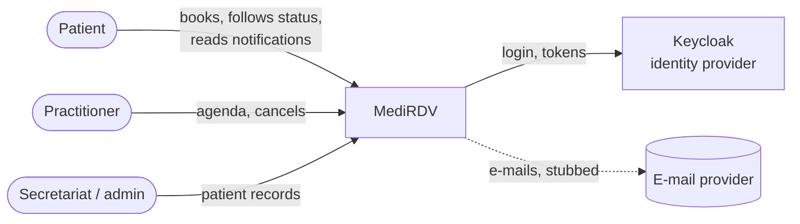
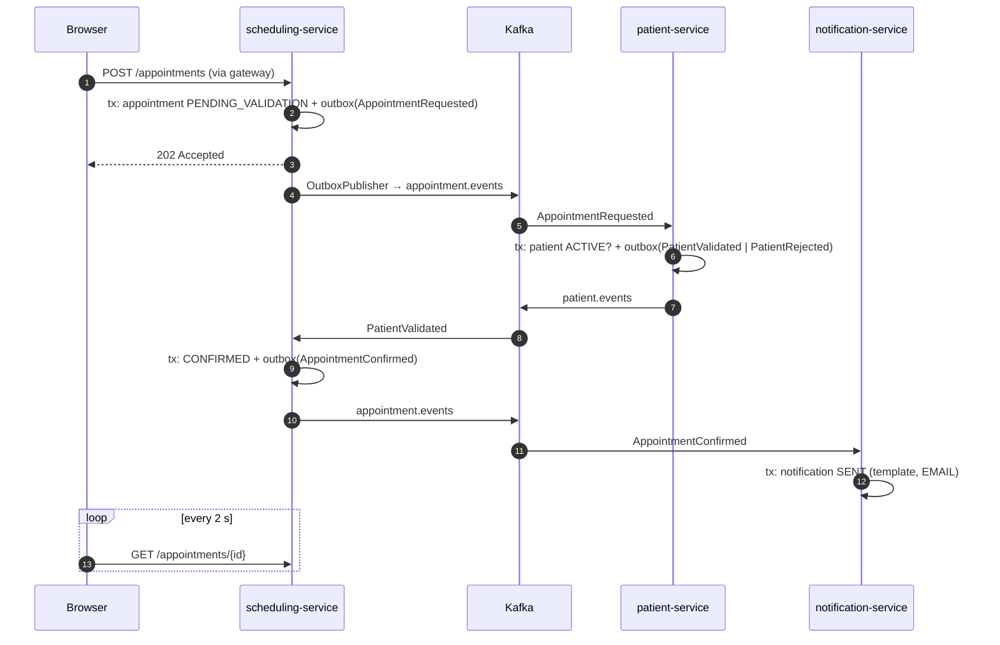
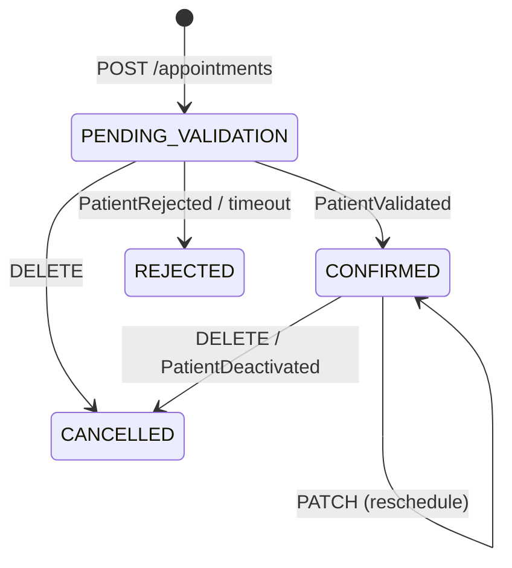

# Architecture

MediRDV is a small Doctolib-style booking product split into four Spring Boot services and an
Angular app. Services own their data (one PostgreSQL database each) and talk to each other only
through Kafka events. Synchronous traffic only flows from the browser to the gateway.

## Context (C4 level 1)



## Containers (C4 level 2)

```mermaid
flowchart TB
    browser[Angular 20 SPA<br/>nginx :8204] -->|/api + JWT| gw[gateway :8200<br/>Spring Cloud Gateway]
    browser -->|OIDC code + PKCE| kc[Keycloak :8280<br/>realm medirdv]
    gw -->|/patients| ps[patient-service :8201]
    gw -->|/practitioners, /appointments| ss[scheduling-service :8202]
    gw -->|/notifications| ns[notification-service :8203]
    ps --- pdb[(patients DB)]
    ss --- sdb[(scheduling DB)]
    ns --- ndb[(notifications DB)]
    ss <-->|appointment.events / patient.events| k{{Kafka KRaft}}
    ps <--> k
    ns <--|appointment.events<br/>retry topics, notification.dlt| k
    gw & ps & ss & ns -.->|JWKS| kc
    gw & ps & ss & ns -.->|OTLP traces| tempo[Tempo]
    prom[Prometheus] -.->|/actuator/prometheus| gw & ps & ss & ns
```

| Container | Responsibility | Data |
|---|---|---|
| gateway | Single entry point, JWT validation, routing (`/api/x/**` → service `/x/**`), CORS for the dev server | none |
| patient-service | Patient records (CRUD, deactivation), saga step 2: validates the patient of a booking | patients, outbox, processed_events |
| scheduling-service | Practitioners, weekly availabilities, free-slot computation, appointments, saga state machine and timeout | practitioners, availabilities, appointments, outbox, processed_events |
| notification-service | Builds and "sends" (logging stub) the e-mails of appointment events, retry topics + DLT | notifications, processed_events |
| web | Angular SPA served by nginx, which also proxies `/api` to the gateway (same origin) | none |

## Booking saga (choreography)



Compensation: `PatientRejected` → appointment `REJECTED`, slot released, `AppointmentRejected`
published (notified). Timeout: a scheduled job rejects appointments still `PENDING_VALIDATION`
after `SAGA_VALIDATION_TIMEOUT` (2 min) with reason `VALIDATION_TIMEOUT`.
Cancellation: `DELETE /appointments/{id}` → `CANCELLED` + `AppointmentCancelled`.
Deactivation: `PatientDeactivated` → scheduling cancels the patient's future appointments.

### Appointment state machine



## Key mechanisms

- **Transactional outbox** (`platform` module): the state change and the event row are written in
  the same transaction; `OutboxPublisher` polls every 500 ms under a PostgreSQL advisory lock (one
  publishing replica at a time, so `SKIP LOCKED` batches of different replicas cannot reorder the
  events of one appointment), publishes in order with `acks=all` and an idempotent producer, then
  marks them sent. Permanent failures are retried 5 times and then parked as `FAILED`
  (`medirdv_outbox_failed`) so that a poison row never blocks the queue.
  See [ADR 0002](adr/0002-transactional-outbox-polling-publisher.md).
- **Idempotent consumers**: every handled event id is inserted into `processed_events` in the
  consumer transaction (`ON CONFLICT DO NOTHING`); a redelivery is skipped.
- **Ordering**: Kafka key = aggregate id (appointment id, or patient id for `PatientDeactivated`).
- **Double booking protection**: a `btree_gist` exclusion constraint forbids overlapping time
  ranges `tstzrange(start_at, end_at)` of active appointments of a practitioner (even with
  different slot grids), plus a partial unique index on `(practitioner_id, start_at)` and `@Version`
  optimistic locking. Violations answer `409`.
- **Retries / DLT** ([ADR 0004](adr/0004-retry-strategies-per-consumer.md)): saga consumers use blocking
  retries (exponential backoff) then `<topic>.dlt`, keeping per-appointment order; notification-service
  uses `@RetryableTopic` (non-blocking retry topics) then `notification.dlt`, which may reorder
  notifications of one appointment. Malformed messages skip the retries.
- **Cancellation reasons**: events carry a coded `reasonCode` (`PATIENT_REQUEST`,
  `PRACTITIONER_UNAVAILABLE`, `PATIENT_DEACTIVATED`, `OTHER`); the optional free-text comment
  (≤ 500 chars) stays in the scheduling database.
- **Access scoping**: admins see everything; practitioners only appointments / notifications of
  the practitioner record linked to their account (`practitioner_id` claim, mandatory); patients
  only their own. Checks fail closed.
- **Actuator** runs on a management port (9200-9203) reachable only inside the network; only
  health and the Prometheus scrape endpoint are anonymous there. Application ports serve the API only.
- **Security**: Keycloak realm `medirdv`, public client `medirdv-web` (PKCE). Gateway and every
  service are OAuth2 resource servers (defence in depth). Issuer = external URL
  (`http://localhost:8280/...`), keys fetched from the internal URL (`http://keycloak:8080/...`).
  Realm roles → `ROLE_*`; `patient_id` / `practitioner_id` user attributes are mapped into the token.
  The password grant is only enabled on the dev client `medirdv-cli` (scripts); the SPA client
  `medirdv-web` only allows authorization code + PKCE.
- **Tracing**: Micrometer Tracing + OpenTelemetry. The W3C `traceparent` of the request is stored
  in the outbox envelope and set as a Kafka header at publication, so the consumer span joins the
  original trace: one booking = one trace across gateway, scheduling, patient and notification.
- **Logs**: structured JSON (ECS) with `traceId`/`spanId`; personal data is masked in logs
  (`Patient#toString`), events carry identifiers only ([RGPD notes](rgpd.md)).

## Module layout

```
events/        event records + envelope + codec + topic names (no Spring dependency)
platform/      outbox (writer, publisher, backlog gauge), idempotency, JWT roles, security config
*-service/     one Spring Boot app per bounded context
gateway/       Spring Cloud Gateway (WebFlux)
web/           Angular 20 + keycloak-angular
deploy/        Keycloak realm, observability config, Helm chart
```
